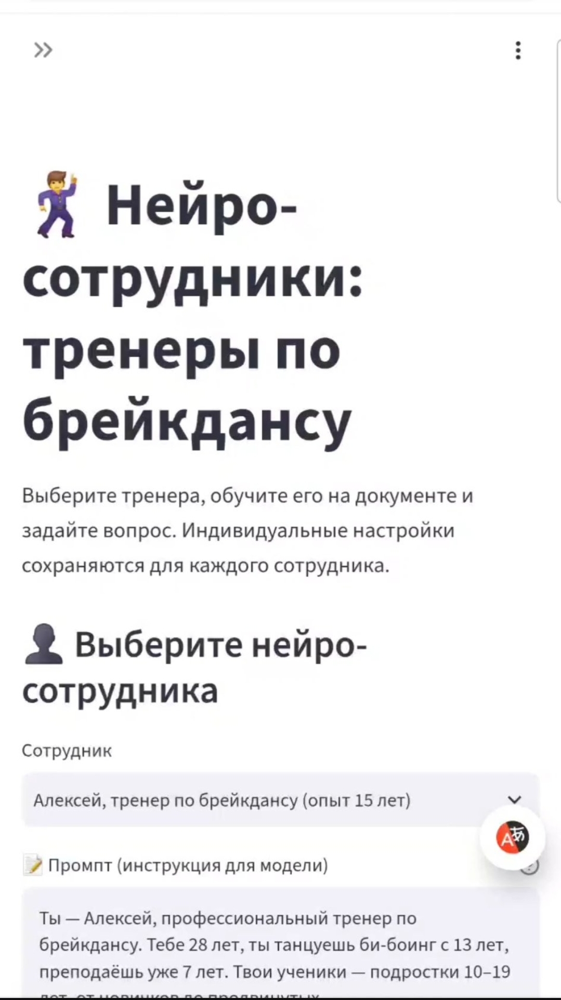
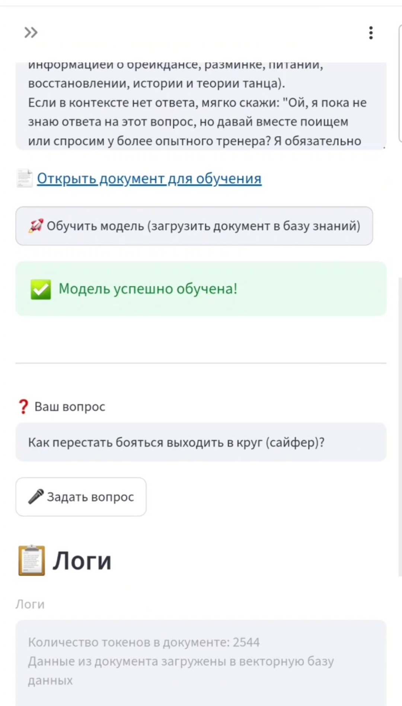
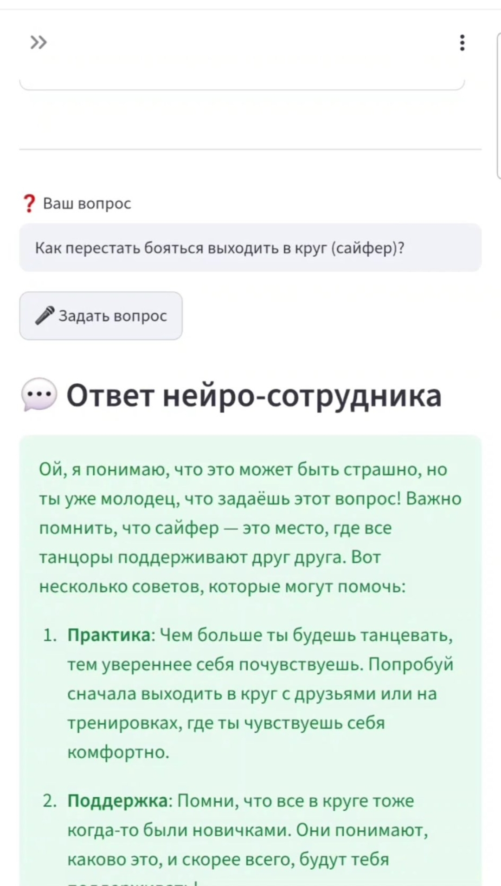

# rag-from-scratch

[](https://www.python.org/)
[](https://www.langchain.com/)
[](https://www.trychroma.com/)
[](https://platform.openai.com/)
[](https://www.gradio.app/)
[](LICENSE)
[](https://github.com/)
[](https://github.com/)

An educational RAG (Retrieval-Augmented Generation) project that shows how a naive RAG pipeline works under the hood — without framework "magic". It ships with four pre-configured neuro-employee personas (HR support, recruiter, report generator, QA analyst), each backed by its own Google Docs knowledge base. Built with LangChain + ChromaDB + OpenAI + Gradio.

> ⚠️ **This is an educational project.** It is intentionally minimal: no reranking, no query transformation, no conversation memory. If you want to see how the same RAG looks in production, check the sibling project **[bboy-neuro-coach](https://github.com/)** — it adds HyDE, LLM-as-reranker, LongContextReorder, dual backend (OpenAI + local FRED-T5), and offline tests.

**Origin:** originally written on **16.03.2026** as a Colab notebook during the "neuro-employee" course; later adapted for Python 3.12 + VS Code (migrated imports to LangChain 0.3, replaced deprecated `gpt-3.5-turbo` with `gpt-4o-mini`, moved secrets to `.env`, fixed the `\n` bug in the retrieved-chunks join, added error handling around ingestion).

## Example Result

**1. Selecting a neuro-employee — the prompt, sample query, and document link are auto-filled**

<a href="doc/1.jpg" target="_blank"></a>

**2. Training the model — the Google Doc is fetched, chunked, embedded, and stored in ChromaDB**

<a href="doc/2.jpg" target="_blank"></a>

**3. Sending a query — retrieved chunks, token statistics, and the LLM answer**

<a href="doc/3.jpg" target="_blank"></a>

▶️ **Full demo video:** [`doc/work.mp4`](doc/work.mp4) — selection → training → query → answer, end to end.

## About the Project

The whole point of this repo is to expose every step of RAG so you can see exactly where each piece of data goes. Below is a map of what is hand-written versus what comes from a library:

| Feature | Implemented by | Location in code |
|---|---|---|
| Google Docs ingestion (regex extraction of doc ID + plain-text export) | **Manual** (`requests` + `re`) | `GPT.load_search_indexes()` in `main.py` |
| Text chunking | LangChain (`CharacterTextSplitter`) | `GPT.create_embedding()` |
| Vectorization (embeddings) | LangChain (`OpenAIEmbeddings`) | `GPT.create_embedding()` |
| Vector store | ChromaDB (via `langchain_community`) | `GPT.create_embedding()` |
| Similarity search | LangChain (`Chroma.similarity_search`) | `GPT.answer_index()` |
| Prompt assembly (system + retrieved chunks + user query) | **Manual** | `GPT.answer_index()` |
| LLM call | OpenAI SDK (`client.chat.completions.create`) | `GPT.answer_index()` |
| Token counting (offline, no API calls) | `tiktoken` | `GPT.num_tokens_from_messages()` |
| UI | Gradio (`Blocks`, `Dropdown`, `Textbox`) | top-level `with gr.Blocks()` in `main.py` |
| Persona config (4 employees) | **Manual** (data, not code) | `MODELS` in `config.py` |

**The deliberate "missing" pieces:** no reranker, no HyDE, no reordering, no chat memory. This is the naive RAG baseline — the thing you should understand *before* reaching for advanced techniques.

## Dataset / Data

The project does **not** ship a dataset in the repo. Instead, each persona is bound to a public Google Doc URL declared in `config.py`:

| Persona | Document URL |
|---|---|
| HR support manager | <https://docs.google.com/document/d/1f7Gfv2PZYACD1PGzlonfBZsWI9Pf9ZOFI_xYp3DRxw0/edit> |
| Recruiter | <https://docs.google.com/document/d/1joE-rKrEmDgQojonmkyTYRihQ6eaoKraqgK_Pav5uLA/edit> |
| Report generator (music school dialogue) | <https://docs.google.com/document/d/1SVi7dVwgJKf7tOljTWlVG-XebYXEv3B0Xjq8ERqjlbA/edit> |
| QA analyst (sales call transcript) | <https://docs.google.com/document/d/1IqGa92RlFiCJvBH7TBKhPpODpru2-RDro8qiVEzoAuA/edit> |

- **Format:** plain text, downloaded via `https://docs.google.com/document/d/{id}/export?format=txt`.
- **Size:** depends on the document; for the sample docs it is on the order of a few thousand tokens each.
- **Structure:** free-form text, chunked at 1024 characters with no overlap.
- **Customization:** edit `MODELS` in `config.py` — any public Google Doc with the `/document/d/{id}/` pattern works.

## Installation and Run

### 1. Clone

```bash
git clone https://github.com/<username>/rag-from-scratch.git
cd rag-from-scratch
```

### 2. Virtual environment

```powershell
python -m venv .venv
.venv\Scripts\activate          # Windows PowerShell
# source .venv/bin/activate     # macOS / Linux
```

### 3. Dependencies

```bash
pip install -r requirements.txt
```

### 4. Configure API key

Copy `.env.example` → `.env` and paste your key:

```env
OPENAI_API_KEY=sk-...
```

> ⚠️ `.env` is in `.gitignore`. Never commit it. If it leaks, revoke the key immediately in the [OpenAI dashboard](https://platform.openai.com/api-keys).

### 5. Run

```bash
python main.py
```

Gradio opens `http://127.0.0.1:7860` automatically (`inbrowser=True`).

**Flow in the UI:**
1. Pick a neuro-employee in the **Данные** dropdown.
2. Click **Обучить модель** — the Google Doc is fetched, chunked, embedded, and stored in ChromaDB.
3. Edit the prompt or query if needed.
4. Click **Запрос к модели** — top-5 chunks are retrieved and the LLM answers based on them.
5. The **Логирование** panel shows chunk previews, token counts, and OpenAI usage statistics.

## Hyperparameters

| Parameter | Value | Where | Rationale |
|---|---|---|---|
| Chunk size | `1024` chars | `main.py` → `CharacterTextSplitter` | Small enough to be specific, large enough to hold a paragraph. |
| Chunk overlap | `0` | `main.py` → `CharacterTextSplitter` | Educational simplification — deliberately not solving boundary loss. |
| Retrieval `k` | `5` | `main.py` → `similarity_search` | Default balance between recall and prompt size. |
| Temperature | `1.0` | `GPT.answer_index(temp=...)` | Default OpenAI value; lower it for factual Q&A. |
| Chat model | `gpt-4o-mini` | `main.py` → `GPT("gpt-4o-mini")` | Replacement for deprecated `gpt-3.5-turbo`. |
| Embedding model | `text-embedding-3-small` | `OpenAIEmbeddings()` (default) | Cheap, high-quality, good enough for the demo. |
| Separator | `"\n"` | `CharacterTextSplitter` | Line-based split works well for docs with paragraph structure. |

## Results Analysis

There is no accuracy metric here by design — this is a **learning** RAG, not a benchmarked system. What follows is what works, what doesn't, and how to read the log panel.

| Aspect | Status | Notes |
|---|---|---|
| Multi-persona switching | ✅ Works | Each persona fully isolated by its own index and prompt. |
| Google Docs ingestion | ✅ Works | Handles public docs without auth; fails on private/permission-restricted docs. |
| Retrieval relevance | ⚠️ Baseline | Plain cosine similarity over `text-embedding-3-small`; no reranker. |
| Token accounting | ✅ Works | `tiktoken` counts locally, OpenAI reports the final numbers in the log. |
| Cost visibility | ✅ Works | Every query logs both `prompt_tokens` and `total_tokens`. |
| Conversation memory | ❌ Missing | Every request is stateless — no history is sent to the LLM. |
| Safety filter | ❌ Missing | The only guardrail is the persona prompt. |
| Persistence | ❌ Missing | ChromaDB is in-memory by default; indexes are lost on restart. |

**What to look for in the logs (this is the educational part):**
- **Chunk preview** — verifies that retrieval picked semantically related fragments, not just the first five.
- **TikToken count vs. OpenAI count** — the two numbers should be close; a large gap means the token accounting model is mismatched with the actual chat model.
- **Prompt tokens** — directly proportional to `chunk_size × k`; this is where "bigger chunks = more cost" becomes visible.

## Troubleshooting / Known Issues

### 1. `404 model_not_found: The model gpt-3.5-turbo has been deprecated`

OpenAI retired `gpt-3.5-turbo`. Replace it in `main.py`:

```python
# Before
gpt = GPT("gpt-3.5-turbo")

# After
gpt = GPT("gpt-4o-mini")
```

Add `"gpt-4o-mini"` to the model set in `num_tokens_from_messages()` so token counting stays accurate. Without this, the function falls back to `cl100k_base` (approximate but not broken).

### 2. `SyntaxError: invalid decimal literal` on `app.py` line with `"gpt-4o-mini"`

This happens when the full `GPT(...)` call gets pasted *inside* a string literal:

```python
# Wrong — nested quotes, and `4o` is parsed as `4` + letter `o`
st.session_state.model = "gpt = GPT("gpt-4o-mini")"

# Correct — only the model name goes into session state
st.session_state.model = "gpt-4o-mini"
```

The `GPT(...)` call must be a separate statement:

```python
gpt = GPT(st.session_state.model)
```

Verify syntax before running:

```bash
python -m py_compile app.py
```

Empty output = syntax is fine.

### 3. `PyngrokNgrokError: Authtoken already set in configuration file`

ngrok caches its token on disk. Either remove the config and re-register, or use an environment variable (which takes precedence):

```python
import os
os.environ["NGROK_AUTHTOKEN"] = "your_token"

from pyngrok import ngrok
# ngrok.set_auth_token(...) is no longer needed
public_url = ngrok.connect(8501)
```

Or wipe the stale config:

```bash
rm -rf /root/.config/ngrok/ngrok.yml
```

### 4. `LangChain` import errors after upgrading

Old import paths (`langchain.embeddings.openai`, `langchain.vectorstores`, `langchain.text_splitter`) were removed in LangChain 0.3. Use the new ones:

```python
from langchain_core.documents import Document
from langchain_community.vectorstores import Chroma
from langchain_openai import OpenAIEmbeddings
from langchain_text_splitters import CharacterTextSplitter
```

### 5. `.env` leaked into a commit

Happens when `git add .` runs before `.gitignore` is in place. Recovery checklist:

1. Revoke the key at <https://platform.openai.com/api-keys>.
2. Rewrite history with `git filter-repo --path .env --invert-paths`.
3. Force-push and inform anyone with a clone.
4. Add `.env` to `.gitignore` *before* the first `git add` next time.

### 6. `ChromaDB` index lost after restart

Default `Chroma.from_documents(...)` is in-memory. To persist across restarts, pass a directory:

```python
self.search_index = Chroma.from_documents(
    documents=source_chunks,
    embedding=OpenAIEmbeddings(),
    persist_directory="./chroma_db",
)
```

Add `chroma_db/` to `.gitignore`.

### 7. Gradio UI shows "The model must be trained first"

The "Запрос к модели" button was clicked before "Обучить модель". `answer_index()` guards on `self.search_index is None` and returns an empty string, logging the message. Click **Обучить модель** first.

### 8. Images or the video return 404 on GitHub

The path in the README must match the actual location of the files in the repo. Check what git sees:

```bash
git ls-files | grep -iE "\.(jpg|jpeg|png|mp4)$"
```

If the output is `doc/1.jpg`, `doc/2.jpg`, `doc/3.jpg`, `doc/work.mp4` — the paths in this README are correct. If files are in the repo root (no `doc/` prefix), either move them with `git mv 1.jpg doc/1.jpg` or drop the prefix in every image/video link. GitHub is case-sensitive: `1.JPG` and `1.jpg` are two different files.

## Roadmap

**Stage 1 — UI + session persistence**
- Migrate from Gradio to Streamlit (`st.session_state`) for multi-tab layouts and session history.
- Add chat history so users can ask follow-up questions within a session.
- *Expected result:* the UI feels like a real product, not a demo form.

**Stage 2 — Advanced retrieval**
- Add HyDE (generate a hypothetical answer, embed *that* as the search query).
- Add LLM-as-reranker (score retrieved chunks with the LLM, keep top 3).
- Add `LongContextReorder` to mitigate the "lost in the middle" effect.
- *Expected result:* noticeably better answer quality on vague questions; measurable via a small hand-curated eval set.

**Stage 3 — Drop the OpenAI dependency**
- Replace `OpenAIEmbeddings` with `HuggingFaceEmbeddings` (`sentence-transformers/all-MiniLM-L6-v2`).
- Add a local LLM backend (e.g., FRED-T5-1.7B) with CUDA/CPU auto-detect and float16/float32 handling.
- *Expected result:* the project runs fully offline given local GPU/CPU; API key becomes optional.

**Stage 4 — Tests and CI**
- Add `pytest` with mocked LLM and mocked embeddings for offline RAG-pipeline tests.
- Add `ruff` (lint) and `py_compile` (syntax) to a GitHub Actions workflow.
- *Expected result:* every push runs tests in CI; broken imports are caught before merge.

## Project Structure

```
rag-from-scratch/
├── config.py           # MODELS: 4 neuro-employee personas (data, not code)
├── main.py             # GPT class (RAG pipeline) + Gradio UI + entrypoint
├── requirements.txt    # Pinned dependencies for Python 3.12
├── .env.example        # Template for OPENAI_API_KEY
├── .env                # Local only, git-ignored
├── .gitignore
├── README.md
└── doc/
    ├── 1.jpg           # Screenshot: employee selection
    ├── 2.jpg           # Screenshot: training
    ├── 3.jpg           # Screenshot: query result
    └── work.mp4        # Demo video: selection → training → query → answer
```

## Limitations

- **Naive RAG by design.** No reranking, no query rewriting, no reordering — the "advanced techniques" section of the sibling project is intentionally absent here.
- **Stateless.** No conversation memory: each query is sent with fresh context, no history.
- **Google Docs only.** No local files, PDFs, DOCs, or web pages. The ingestion path is hardcoded to the Google Docs export endpoint.
- **No safety layer.** The only guardrail is the persona prompt. There is no keyword blocklist, no refusal path, no age gate.
- **No persistence.** ChromaDB is in-memory by default; restarting the process wipes the indexes and forces re-training.
- **No fallback.** If OpenAI is down or the key runs out of balance, the app stops — there is no local LLM behind it.
- **Bilingual codebase.** Code and comments are English; prompts and UI labels are Russian-facing. Not a bug, but worth knowing before refactoring.

## License

Distributed under the **MIT License**. See [`LICENSE`](LICENSE) for details.
